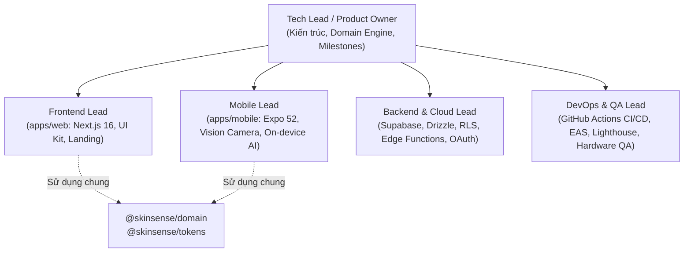

# 🗺️ SkinSense v2 — Engineering Roadmap & Team Operating Guide

> **Live Interactive GitHub Project Board**:  
> 👉 [**SkinSense v2 - Team Roadmap & Engineering Tracker**](https://github.com/users/Tranthingocha-teo/projects/2)  
> *(Tích hợp trực tiếp với GitHub Issues, Milestones, Custom Tracks & Phân bổ vai trò thành viên)*

---

## 1. 👥 Team Topology & Phân công Vai trò (Multi-Person Team)

Dự án SkinSense v2 được thiết kế theo kiến trúc monorepo chuẩn hóa (Turborepo + Bun), phân tách rõ ràng theo domain để nhiều thành viên có thể phát triển độc lập mà không bị giẫm chân lên nhau (merge conflicts).



### Chi tiết phân vai:
1. **Frontend Lead (Web)**:
   - **Workspace**: `apps/web`
   - **Trách nhiệm**: Giao diện người dùng Web, Landing Page 3D Particle Face stage, Dashboard "Hôm Nay", Routine Checklist, Trends Analytics & Radar Chart, Web E2E testing (Playwright).
2. **Mobile Lead (Android/iOS)**:
   - **Workspace**: `apps/mobile`
   - **Trách nhiệm**: Native Vision Camera với Face Landmarker on-device TFLite, Đánh dấu nốt mụn (Spot Marking), Native gestures & Reanimated, Biometric lock, Local notifications, Maestro testing.
3. **Backend & Cloud Lead**:
   - **Workspace**: `supabase/`, `packages/domain/drizzle/`
   - **Trách nhiệm**: CSDL PostgreSQL, Drizzle migrations, Supabase Storage bucket policy (RLS), Google Cloud OAuth 2.0, Edge Functions (`delete-account`), Vercel keep-alive cron.
4. **DevOps & QA Lead**:
   - **Workspace**: `.github/workflows/`, `scripts/`
   - **Trách nhiệm**: CI Pipeline tự động, EAS Build & Keystore, Kiểm thử thiết bị vật lý Android, Audit Lighthouse hiệu năng web, Release management.
5. **Tech Lead / Core Domain**:
   - **Workspace**: `packages/domain`, `packages/tokens`
   - **Trách nhiệm**: Thuật toán tính toán chỉ số đỏ (Redness Index, CIE $L^*a^*b^*$), Face landmark geometry, Shared tokens, Review kiến trúc tổng thể.

---

## 2. 📅 Lộ trình Milestones & Kế hoạch Thực thi

### 🏁 Milestone 1: Monorepo Foundation & Domain Engine `[Hoàn thành]`
*Nền móng monorepo, thuật toán xử lý ảnh, schema CSDL và bộ design tokens.*
- [x] `#1` **feat(setup)**: Monorepo Foundation, Turborepo, Bun tooling & docs
- [x] `#2` **feat(tokens)**: Shared Design Tokens & Theme Foundation
- [x] `#3` **feat(domain)**: Core Domain Engine — Redness, Zones & Geometry Algorithms
- [x] `#4` **feat(database)**: Schema, Drizzle Migrations (0000-0004) & Storage RLS

---

### 🎨 Milestone 2: Core Diary Features & UI Shell `[Hoàn thành]`
*Toàn bộ tính năng nhật ký da mặt cốt lõi trên cả Web và Android.*
- [x] `#5` **feat(routine)**: Daily Routine Checklist & Streak Tracking
- [x] `#6` **feat(capture)**: Guided Camera Capture Engine & Quality Validation
- [x] `#7` **feat(spots)**: Interactive Acne & Spot Marking Module
- [x] `#8` **feat(analytics)**: Skin Trends Analytics & Multi-Date Progress Comparison
- [x] `#9` **feat(auth)**: Authentication, Settings & Backend-Free Demo Mode
- [x] `#10` **feat(shell)**: Application Shell, Navigation & "Hôm Nay" Dashboard
- [x] `#11` **feat(features)**: Photo Detail Notes, Tags, Reminders & User Feedback
- [x] `#12` **feat(web)**: Public Landing, 3D Particle Face Stage & Component Library
- [x] `#13` **feat(mobile)**: Mobile Architecture, Native UI Kit, Fonts & Build Configuration

---

### 🛡️ Milestone 3: CI/CD Pipeline & Audit Records `[Hoàn thành]`
*Đảm bảo chất lượng mã nguồn tự động và bàn giao tài liệu kỹ thuật.*
- [x] `#14` **ci(test)**: GitHub Actions CI Pipeline & Automated Test Suites (300+ tests)
- [x] `#15` **docs(handoff)**: Project Audit Records, Technical Specs & Final Delivery

---

### 🚀 Milestone 4: Production Cloud & App Launch (v1.0.0) `[Sprint hiện tại]`
*Đưa hệ thống lên môi trường thật, triển khai Cloud và đóng gói ứng dụng phát hành.*

| Issue | Nhiệm vụ | Vai trò | Track | Độ ưu tiên |
|---|---|---|---|---|
| `#16` | **Provision Supabase Backend & Apply Drizzle Migrations** | Backend Lead | Backend & Cloud | `P0 - Blocker` |
| `#17` | **Configure Google Cloud OAuth 2.0 (Web & Android Clients)** | Backend Lead | Backend & Cloud | `P0 - Blocker` |
| `#18` | **Deploy Web Application to Vercel** | Frontend Lead | Web (Next.js) | `P0 - Blocker` |
| `#19` | **Setup Supabase Keep-Alive Cron** | Backend Lead | Backend & Cloud | `P1 - High` |
| `#20` | **Setup EAS Credentials, Keystore & Build APK v1.0.0** | Mobile Lead | Mobile (Expo) | `P0 - Blocker` |
| `#21` | **Execute Android Manual QA on Physical Hardware** | DevOps & QA | DevOps & QA | `P1 - High` |
| `#22` | **Run Production Lighthouse Audit on Deployed Web App** | DevOps & QA | DevOps & QA | `P1 - High` |
| `#23` | **Publish Release v1.0.0 on GitHub Releases** | Tech Lead | DevOps & QA | `P0 - Blocker` |

---

### 🌟 Milestone 5: Team Expansion & Next Horizons (v1.1.0) `[Lộ trình tương lai]`
*Các tính năng nâng cao phục vụ mở rộng người dùng và nghiên cứu phát triển.*

| Issue | Nhiệm vụ | Vai trò | Track | Độ ưu tiên |
|---|---|---|---|---|
| `#24` | **iOS Camera & MediaPipe Face Landmarker Support** | Mobile Lead | Mobile (Expo) | `P1 - High` |
| `#25` | **Offline-First Photo & Routine Sync Queue with Local SQLite** | Backend Lead | Backend & Cloud | `P1 - High` |
| `#26` | **Dermatologist Consultation PDF Report Generator** | Frontend Lead | Web (Next.js) | `P2 - Medium` |
| `#27` | **Android & iOS Home Screen Widget for Routine Streak** | Mobile Lead | Mobile (Expo) | `P2 - Medium` |
| `#28` | **Auto Skin Tone Adaptive Calibration for Multi-Ethnic Redness** | Tech Lead | Core Domain / Vision | `P2 - Medium` |
| `#29` | **Automated EAS Preview Build Pipeline on GitHub Actions** | DevOps & QA | DevOps & QA | `P1 - High` |

---

## 3. 🛠️ Quy trình Làm việc Nhóm (Team Workflow & Git Strategy)

### A. Chiến lược Nhánh (Branching Strategy)
- `main`: Nhánh production, luôn ở trạng thái pass CI (locked, không push trực tiếp).
- Mỗi thành viên tạo nhánh từ `main` theo quy tắc:
  - `feat/<issue-id>-<tên-ngắn-gọn>` (ví dụ: `feat/18-deploy-vercel`)
  - `fix/<issue-id>-<tên-ngắn-gọn>`
  - `docs/<issue-id>-<tên-ngắn-gọn>`

### B. Quy tắc Pull Request & Definition of Done (DoD)
Mọi Pull Request muốn được merge phải thỏa mãn:
1. **Liên kết Issue**: Ghi rõ `Closes #<id>` trong mô tả PR để tự động cập nhật trạng thái trên Project board.
2. **Kiểm tra tự động (CI Gate)**:
   ```bash
   bun run typecheck   # Toàn bộ 5 workspaces 0 lỗi TypeScript
   bun run test        # Tất cả test suites pass 100%
   ```
3. **Review**: Có ít nhất 1 thành viên review và approve trước khi squash and merge.

---

## 4. 📊 Hướng dẫn Sử dụng GitHub Projects Board

Khi truy cập [**GitHub Project #2**](https://github.com/users/Tranthingocha-teo/projects/2), team có thể chuyển đổi giữa các chế độ xem tối ưu:

1. **Board (Kanban)**: Xem tổng quan thẻ theo trạng thái `Todo` ➔ `In Progress` ➔ `Done`.
2. **Roadmap (Timeline View)**: Xem lộ trình theo thanh thời gian (Gantt chart) dựa trên trường `Target Date` và `Milestones`.
3. **By Track**: Nhóm công việc theo từng mảng chuyên môn (`Web`, `Mobile`, `Backend`, `Core Domain`, `DevOps`) để từng lead nắm rõ task của mình.
4. **By Priority**: Lọc các task `P0 - Blocker` để ưu tiên giải quyết trước.
