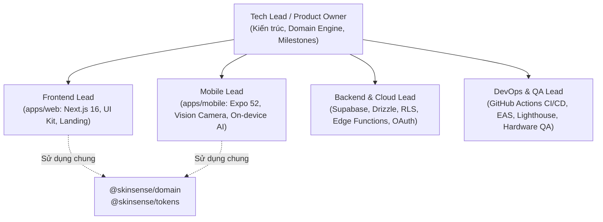

# 🗺️ SkinSense v2 — Engineering Roadmap & Team Operating Guide

> **Live Interactive GitHub Project Board**:  
> 👉 [**SkinSense v2 - Team Roadmap & Engineering Tracker**](https://github.com/users/Tranthingocha-teo/projects/2)  
> *(Tích hợp trực tiếp với GitHub Issues, Milestones, Custom Tracks & Phân bổ vai trò thành viên)*

---

## 1. 👥 Team Topology & Phân công Vai trò (Multi-Person Team)

Dự án SkinSense v2 được thiết kế theo kiến trúc monorepo chuẩn hóa (Turborepo + Bun), phân tách rõ ràng theo domain để nhiều thành viên có thể phát triển độc lập mà không bị giẫm chân lên nhau (merge conflicts).



### Chi tiết phân vai:
1. **Frontend Lead (Web)**:
   - **Workspace**: `apps/web`
   - **Trách nhiệm**: Giao diện người dùng Web, Landing Page 3D Particle Face stage, Dashboard "Hôm Nay", Routine Checklist, Trends Analytics & Radar Chart, Web E2E testing (Playwright).
2. **Mobile Lead (Android/iOS)**:
   - **Workspace**: `apps/mobile`
   - **Trách nhiệm**: Native Vision Camera với Face Landmarker on-device TFLite, Đánh dấu nốt mụn (Spot Marking), Native gestures & Reanimated, Biometric lock, Local notifications, Maestro testing.
3. **Backend & Cloud Lead**:
   - **Workspace**: `supabase/`, `packages/domain/drizzle/`
   - **Trách nhiệm**: CSDL PostgreSQL, Drizzle migrations, Supabase Storage bucket policy (RLS), Google Cloud OAuth 2.0, Edge Functions (`delete-account`), Vercel keep-alive cron.
4. **DevOps & QA Lead**:
   - **Workspace**: `.github/workflows/`, `scripts/`
   - **Trách nhiệm**: CI Pipeline tự động, EAS Build & Keystore, Kiểm thử thiết bị vật lý Android, Audit Lighthouse hiệu năng web, Release management.
5. **Tech Lead / Core Domain**:
   - **Workspace**: `packages/domain`, `packages/tokens`
   - **Trách nhiệm**: Thuật toán tính toán chỉ số đỏ (Redness Index, CIE $L^*a^*b^*$), Face landmark geometry, Shared tokens, Review kiến trúc tổng thể.

---

## 2. 📅 Lộ trình Milestones & Kế hoạch Thực thi

### 🏁 Milestone 1: Monorepo Foundation & Domain Engine `[Hoàn thành]`
*Nền móng monorepo, thuật toán xử lý ảnh, schema CSDL và bộ design tokens.*
- [x] `#1` **feat(setup)**: Monorepo Foundation, Turborepo, Bun tooling & docs
- [x] `#2` **feat(tokens)**: Shared Design Tokens & Theme Foundation
- [x] `#3` **feat(domain)**: Core Domain Engine — Redness, Zones & Geometry Algorithms
- [x] `#4` **feat(database)**: Schema, Drizzle Migrations (0000-0004) & Storage RLS

---

### 🎨 Milestone 2: Core Diary Features & UI Shell `[Hoàn thành]`
*Toàn bộ tính năng nhật ký da mặt cốt lõi trên cả Web và Android.*
- [x] `#5` **feat(routine)**: Daily Routine Checklist & Streak Tracking
- [x] `#6` **feat(capture)**: Guided Camera Capture Engine & Quality Validation
- [x] `#7` **feat(spots)**: Interactive Acne & Spot Marking Module
- [x] `#8` **feat(analytics)**: Skin Trends Analytics & Multi-Date Progress Comparison
- [x] `#9` **feat(auth)**: Authentication, Settings & Backend-Free Demo Mode
- [x] `#10` **feat(shell)**: Application Shell, Navigation & "Hôm Nay" Dashboard
- [x] `#11` **feat(features)**: Photo Detail Notes, Tags, Reminders & User Feedback
- [x] `#12` **feat(web)**: Public Landing, 3D Particle Face Stage & Component Library
- [x] `#13` **feat(mobile)**: Mobile Architecture, Native UI Kit, Fonts & Build Configuration

---

### 🛡️ Milestone 3: CI/CD Pipeline & Audit Records `[Hoàn thành]`
*Đảm bảo chất lượng mã nguồn tự động và bàn giao tài liệu kỹ thuật.*
- [x] `#14` **ci(test)**: GitHub Actions CI Pipeline & Automated Test Suites (300+ tests)
- [x] `#15` **docs(handoff)**: Project Audit Records, Technical Specs & Final Delivery

---

### 🚀 Milestone 4: Production Cloud & App Launch (v1.0.0) `[Sprint 1 — Completed]`
*Đưa hệ thống lên môi trường thật, triển khai Cloud và đóng gói ứng dụng phát hành.*

| Issue | Nhiệm vụ | Vai trò | Track | Độ ưu tiên |
|---|---|---|---|---|
| `#16` | **Provision Supabase Backend & Apply Drizzle Migrations** | Tech Lead (`@Tranthingocha-teo`) | Backend & Cloud | `P0 - Blocker` |
| `#17` | **Configure Google Cloud OAuth 2.0 (Web & Android Clients)** | Tech Lead (`@Tranthingocha-teo`) | Backend & Cloud | `P0 - Blocker` |
| `#18` | **Deploy Web Application to Vercel** | Tech Lead (`@Tranthingocha-teo`) | Web (Next.js) | `P0 - Blocker` |
| `#19` | **Setup Supabase Keep-Alive Cron** | Tech Lead (`@Tranthingocha-teo`) | Backend & Cloud | `P1 - High` |
| `#20` | **Setup EAS Credentials, Keystore & Build APK v1.0.0** | Tech Lead (`@Tranthingocha-teo`) | Mobile (Expo) | `P0 - Blocker` |
| `#21` | **Execute Android Manual QA on Physical Hardware** | DevOps & QA (`@Tranthingocha-teo`) | DevOps & QA | `P1 - High` |
| `#22` | **Run Production Lighthouse Audit on Deployed Web App** | DevOps & QA (`@Tranthingocha-teo`) | DevOps & QA | `P1 - High` |
| `#23` | **Publish Release v1.0.0 on GitHub Releases** | Tech Lead (`@Tranthingocha-teo`) | DevOps & QA | `P0 - Blocker` |

---

### 🧩 Milestone 6: Sprint 2 — Multi-Role Platform, Shopee Mall, Media & QA `[Sprint 2 — 94/97 SP Complete]`
*Mở rộng từ ứng dụng nhật ký đơn lẻ v1.0.0 thành nền tảng da liễu đa vai trò (`customer`, `shop`, `specialist`, `admin`) và thương mại điện tử dược mỹ phẩm Shopee Mall (`CR-01`..`CR-05`).*

| Issue | Nhiệm vụ | Người phụ trách | SP | Trạng thái |
|---|---|---|---|---|
| `#75` | **First Sprint 2 Baseline**: 4-Role Auth, Early Marketplace & Editorial Routine | `@Tranthingocha-teo` | 8 | `Done` (`2026-11-03`) |
| `#30` | **Team Onboarding**: Welcome `@dinhthianhsang` & `@thuyydung` | `@Tranthingocha-teo`, `@thuyydung`, `@dinhthianhsang` | 1 | `Done` |
| `#31` | **Admin 4-Role User Management & Shop Moderation** | `@Tranthingocha-teo`, `@thuyydung` | 5 | `Done` (`PR #32, #43`) |
| `#33` | **Specialist Dermatology Portal & Doctor Profile** | `@Tranthingocha-teo`, `@thuyydung` | 5 | `Done` (`PR #34, #44`) |
| `#35` | **Shopee Mall Product Selling & Storefront** | `@Tranthingocha-teo`, `@thuyydung` | 5 | `Done` (`PR #36, #64–#66`) |
| `#47`, `#60` | **Shopee Mall Checkout, MoMo QR & 4-Role Profiles** | `@thuyydung` | 10 | `Done` (`PR #48`) |
| `#76` | **Supabase Seed Architecture, Google OAuth & Super Admin Guard** | `@Tranthingocha-teo` | 8 | `Done` (`PR #37–#39`) |
| `#77` | **Admin Supabase Backend APIs (Users, Specialists, Products, Orders)** | `@Tranthingocha-teo` | 8 | `Done` (`PR #40–#43`) |
| `#78` | **Specialist Clinical Cases API, Allergy Alerts & Validation** | `@Tranthingocha-teo` | 5 | `Done` (`PR #44, #54, #56, #58`) |
| `#79` | **Morning/Evening Routine Sync & Per-User Multi-Tenant Isolation** | `@Tranthingocha-teo` | 5 | `Done` (`PR #45–#46, #62–#63`) |
| `#80` | **Admin Shop Approval Gate & Shop Name Data Isolation** | `@Tranthingocha-teo` | 8 | `Done` (`PR #64–#66`) |
| `#81` | **Signed Server Upload, Device/Camera Uploader & Checkout Gallery** | `@Tranthingocha-teo` | 8 | `Done` (`PR #67–#74`) |
| `#82` | **Multi-Tenant API Test Suites, `SafeProductImage` & Accessibility** | `@Tranthingocha-teo` | 5 | `Done` (`PR #50–#53, #55, #57, #59`) |
| `#83` | **Seller Payment UI & `PR #49` Revision Review** | `@dinhthianhsang` | 5 | `Done` (`PR #61`; `PR #49` `In Progress`) |
| `#84` | **Fix 69 Web ESLint Errors, Enforce `lint` & `build` in CI, Add Templates** | `@Tranthingocha-teo` | 5 | `Done` (`PR #86`) |
| `#85` | **Sprint 1 & 2 Plans, Burndowns, Reviews, Retros & Risk Governance Docs** | `@Tranthingocha-teo` | 3 | `Done` (`PR #87`) |
| `#29` | **Automated EAS Preview Build Pipeline on GitHub Actions** | `@Tranthingocha-teo`, `@dinhthianhsang` | 3 | `In Review` *(Preflight green; awaits `EXPO_TOKEN`)* |

---

### 🌟 Milestone 5: Team Expansion & Next Horizons (v1.1.0) `[Backlog tương lai]`
*Các tính năng nâng cao phục vụ mở rộng người dùng và nghiên cứu phát triển (`31 SP`).*

| Issue | Nhiệm vụ | Vai trò | Track | Độ ưu tiên |
|---|---|---|---|---|
| `#24` | **iOS Camera & MediaPipe Face Landmarker Support** | Mobile Lead (`@dinhthianhsang`) | Mobile (Expo) | `P1 - High` |
| `#25` | **Offline-First Photo & Routine Sync Queue with Local SQLite** | Tech Lead (`@Tranthingocha-teo`) | Backend & Cloud | `P1 - High` |
| `#26` | **Dermatologist Consultation PDF Report Generator** | Tech Lead (`@Tranthingocha-teo`) | Web (Next.js) | `P2 - Medium` |
| `#27` | **Android & iOS Home Screen Widget for Routine Streak** | Mobile Lead (`@dinhthianhsang`) | Mobile (Expo) | `P2 - Medium` |
| `#28` | **Auto Skin Tone Adaptive Calibration for Multi-Ethnic Redness** | Tech Lead (`@Tranthingocha-teo`) | Core Domain / Vision | `P2 - Medium` |

---

## 3. 🛠️ Quy trình Làm việc Nhóm (Team Workflow & Git Strategy)

### A. Chiến lược Nhánh (Branching Strategy)
- `main`: Nhánh production được bảo vệ bởi Ruleset `"Only Owner Merge"` và CI Gate, không push trực tiếp.
- Mỗi thành viên tạo nhánh từ `main` theo quy tắc Conventional Commits:
  - `feat/<tên-ngắn-gọn>` hoặc `feat/<issue-id>-<tên-ngắn-gọn>`
  - `fix/<tên-ngắn-gọn>`
  - `ci/<tên-ngắn-gọn>` / `docs/<tên-ngắn-gọn>`

### B. Quy tắc Pull Request & Definition of Done (DoD)
Mọi Pull Request muốn được merge phải tuân thủ [`.github/PULL_REQUEST_TEMPLATE.md`](.github/PULL_REQUEST_TEMPLATE.md) và thỏa mãn:
1. **Liên kết Issue**: Ghi rõ `Closes #<id>` trong mô tả PR để tự động đóng Issue và cập nhật trạng thái trên Project board.
2. **Kiểm tra tự động (CI Gate — `.github/workflows/ci.yml`)**:
   ```bash
   bun install --frozen-lockfile
   bun run lint        # 0 lỗi ESLint trên tất cả workspaces
   bun run typecheck   # Toàn bộ 5 workspaces 0 lỗi TypeScript
   bun run test        # Toàn bộ test suites pass 100% (@skinsense/domain, web, mobile)
   bun run build       # Build production Next.js & Tokens không cần secrets
   ```
3. **Review**: Có mô tả tự kiểm thử và ít nhất 1 thành viên khác review/approve trước khi merge.

---

## 4. 📊 Hướng dẫn Sử dụng GitHub Projects & Tài liệu Quản trị

Khi truy cập [**GitHub Project #2**](https://github.com/users/Tranthingocha-teo/projects/2), team sử dụng cấu trúc Kanban **5 cột chuẩn** và hệ thống báo cáo đồng bộ:

1. **Board — 5-Column Workflow**: Luồng trạng thái `Backlog` ➔ `Ready` ➔ `In Progress` ➔ `In Review` ➔ `Done`.
2. **Table — Master WBS & Story Points**: Bảng tổng hợp đầy đủ `Story Points`, `Sprint`, `Track`, `Priority`, `Phase`, `Target Date`.
3. **Sprint 1 & Sprint 2 Views**: Theo dõi riêng các hạng mục thuộc `Sprint 1 (Weeks 1-6)` và `Sprint 2 (Weeks 7-11)`.
4. **Roadmap Timeline**: Lộ trình theo thanh thời gian dựa trên trường `Target Date` và `Milestones`.

### Bộ Tài Liệu Scrum & Quản Trị Rủi Ro
- [Sprint 1 Plan, Burndown, Review & Retrospective](docs/sprints/SPRINT_1.md)
- [Sprint 2 Plan, Burndown, Review & Final Retrospective](docs/sprints/SPRINT_2.md)
- [Dynamic Risk Register (Week 6 ➔ Week 11) & GitHub Evidence Index](docs/governance/RISK_REGISTER.md)
- [Formal Change Request Log (`CR-01`..`CR-05`)](docs/governance/CHANGE_REQUESTS.md)
- [Requirements & WBS Traceability Matrix](docs/governance/TRACEABILITY_MATRIX.md)
