# BÁO CÁO 2: CƠ CẤU PHÂN RÃ CÔNG VIỆC (WBS & WBS DICTIONARY)
**HỌC PHẦN:** QUẢN TRỊ DỰ ÁN PHẦN MỀM (SPM) — VKU  
**DỰ ÁN:** SKINSENSE V2 (`VKU-SPM-SKINSENSE02`)  
**NHÓM THỰC HIỆN:** **NHÓM WINX (3 THÀNH VIÊN: HÀ, SÁNG, DUNG)**  
**TIÊU CHUẨN:** TUÂN THỦ 100% RULE & PHÂN BỔ ĐỀU CÔNG VIỆC THEO NĂNG LỰC  

---

## 1. NGUYÊN TẮC THIẾT KẾ CÂY WBS (100% RULE)

* **Nguyên tắc bao trùm (100% Rule):** Cây WBS bao quát toàn bộ 100% phạm vi công việc của dự án `SkinSense v2`, phân bổ mạch lạc và công bằng giữa 3 thành viên theo đúng các tính năng thực tế đã cam kết:
  * **Hà phụ trách:** Nền tảng hạ tầng CSDL, Phân hệ Bác sĩ da liễu (`/specialist`) và Phân hệ Quản trị Super Admin (`/admin`).
  * **Sáng phụ trách:** Phân hệ Sàn Dược mỹ phẩm (`/shop`) và Phân hệ Kênh Người bán (Seller Center) tích hợp 4 bảng CSDL.
  * **Dung phụ trách:** Phân hệ Hồ sơ độc lập 4 Role, Quản lý đơn mua User tự hủy sau 3 ngày, Thanh toán MoMo QR thời gian thực và Bộ kiểm thử tự động QA (Vitest 118 tests).

---

## 2. SƠ ĐỒ CÂY PHÂN RÃ CÔNG VIỆC WBS (WBS TREE STRUCTURE)

> 💡 **GỢI Ý COPY VÀO BÁO CÁO (WORD / GOOGLE DOCS):**  
> Dưới đây là **Sơ đồ cây dạng văn bản phân cấp chuẩn (Text Tree)** có nền sáng, rõ ràng từng nhánh, bạn chỉ cần copy nguyên khối này dán thẳng vào Word/Google Docs là hiển thị sắc nét 100%, không bao giờ bị đen hay vỡ khung!  
> *(Bạn cũng có thể mở file trực quan đồ họa tại: [`WBS_Tree_View.html`](file:///D:/D/skinsense-v2/docs/qlda/WBS_Tree_View.html) để in/lưu sang ảnh hoặc PDF).*

```text
========================================================================================================
                                 1.0 DỰ ÁN SKINSENSE V2 (NHÓM WINX)
========================================================================================================
├── 1.1 Quản Trị Dự Án & Quy Trình Scrum [Thùy Dung — 33.4%]
│   ├── 1.1.1 Lập Project Charter 13 mục & Thiết lập GitHub Projects Board 5 cột
│   ├── 1.1.2 Thiết kế Cây WBS & Bảng Từ điển WBS chuẩn 100% Rule
│   └── 1.1.3 Quản trị rủi ro qua 2 đợt & Tổ chức họp Sprint Retrospectives (mô hình 4Ls)
│
├── 1.2 Hạ Tầng CSDL & Phân Hệ Bác Sĩ / Super Admin [Trần Thị Ngọc Hà — 33.3%]
│   ├── 1.2.1 Thiết kế Schema CSDL Supabase PostgreSQL & Cấu hình bảo mật RLS
│   ├── 1.2.2 Cổng Bác sĩ da liễu (/specialist) & Quản lý hồ sơ bệnh án, dị ứng da
│   ├── 1.2.3 Dashboard Super Admin (/admin) phê duyệt chứng chỉ CCHN & Gian hàng Shop
│   └── 1.2.4 Chuẩn hóa thanh điều hướng Site Header Navigation & Trợ năng a11y
│
├── 1.3 Sàn Dược Mỹ Phẩm & Seller Center 4 Bảng CSDL [Phan Ánh Sáng — 33.3%]
│   ├── 1.3.1 Sàn Dược mỹ phẩm (/shop) & Phân loại biến thể dung tích chai/tuýp
│   ├── 1.3.2 Thiết kế 4 bảng CSDL Seller: shops, seller_products, orders, withdrawals
│   ├── 1.3.3 Kênh quản trị gian hàng Shopee Mall Flagship & Đăng bán sản phẩm
│   └── 1.3.4 Quản lý đơn bán hàng & Xử lý yêu cầu rút tiền doanh thu người bán
│
├── 1.4 Hồ Sơ 4 Role & Quản Lý Đơn Mua Tự Hủy Sau 3 Ngày [Thùy Dung — 33.4%]
│   ├── 1.4.1 Tách riêng 4 URL Profile độc lập (/user, /specialist, /shop, /admin)
│   ├── 1.4.2 Chế độ xem Label trang nhã & Chỉnh sửa lưu CSDL không thêm cột mới
│   ├── 1.4.3 Quản lý đơn mua cá nhân & Cách ly dữ liệu khách hàng theo tên/sđt
│   └── 1.4.4 Gắn ảnh sản phẩm thực tế sắc nét & Quy tắc tự động hủy đơn sau 3 ngày
│
└── 1.5 Cổng Thanh Toán MoMo QR & Bộ Kiểm Thử Vitest [Thùy Dung — 33.4%]
    ├── 1.5.1 Engine sinh mã MoMo QR Base64 offline tương thích mạng LAN máy dev
    ├── 1.5.2 Màn hình thanh toán di động (/pay-demo) thời gian thực trên điện thoại thật
    └── 1.5.3 Bộ kiểm thử tự động Vitest 28 test files, 118 unit tests (100% PASS)
========================================================================================================
```

### Sơ đồ khối Mermaid (Phiên bản căn chỉnh nền sáng):

```mermaid
graph TD
    Root["1.0 Dự Án SkinSense v2 (Nhóm WinX)"]

    Root --> WBS1["1.1 Quản Trị Dự Án & Quy Trình Scrum<br><b>(Thùy Dung)</b>"]
    Root --> WBS2["1.2 CSDL & Bác Sĩ / Super Admin<br><b>(Ngọc Hà)</b>"]
    Root --> WBS3["1.3 Sàn Mỹ Phẩm & Seller 4 Bảng<br><b>(Ánh Sáng)</b>"]
    Root --> WBS4["1.4 Profile 4 Role & Đơn Mua Tự Hủy<br><b>(Thùy Dung)</b>"]
    Root --> WBS5["1.5 MoMo QR & Bộ Test Vitest<br><b>(Thùy Dung)</b>"]

    %% Nhánh 1.1
    WBS1 --> WBS11["1.1.1 Lập Charter & GitHub Board"]
    WBS1 --> WBS12["1.1.2 Thiết kế WBS 100% Rule"]
    WBS1 --> WBS13["1.1.3 Quản trị rủi ro & Retro 4Ls"]

    %% Nhánh 1.2 - Hà
    WBS2 --> WBS21["1.2.1 Schema Supabase & RLS"]
    WBS2 --> WBS22["1.2.2 Cổng Bác sĩ /specialist"]
    WBS2 --> WBS23["1.2.3 Dashboard Admin /admin"]
    WBS2 --> WBS24["1.2.4 Site Header & Navigation"]

    %% Nhánh 1.3 - Sáng
    WBS3 --> WBS31["1.3.1 Sàn Dược Mỹ phẩm /shop"]
    WBS3 --> WBS32["1.3.2 Thiết kế 4 bảng Seller"]
    WBS3 --> WBS33["1.3.3 Quản trị gian hàng Shop"]
    WBS3 --> WBS34["1.3.4 Đơn bán & Rút tiền"]

    %% Nhánh 1.4 - Dung
    WBS4 --> WBS41["1.4.1 Tách riêng 4 URL Profile"]
    WBS4 --> WBS42["1.4.2 Chế độ Label & Sửa lưu DB"]
    WBS4 --> WBS43["1.4.3 Quản lý đơn mua cá nhân"]
    WBS4 --> WBS44["1.4.4 Ảnh thật & Tự hủy sau 3 ngày"]

    %% Nhánh 1.5 - Dung
    WBS5 --> WBS51["1.5.1 MoMo QR Base64 offline"]
    WBS5 --> WBS52["1.5.2 Màn hình di động /pay-demo"]
    WBS5 --> WBS53["1.5.3 Vitest 118 unit tests PASS"]
```


---

## 3. BẢNG TỪ ĐIỂN WBS CHI TIẾT (WBS DICTIONARY)

| Mã WBS | Tên gói công việc (Work Package) | Mô tả chi tiết kỹ thuật | Tiêu chí nghiệm thu (Definition of Done) | Người phụ trách | GitHub Issue / PR |
| :---: | :--- | :--- | :--- | :---: | :---: |
| **1.1.1** | Khởi tạo Project Charter & Board | Biên soạn điều lệ dự án 13 mục; cấu hình GitHub Projects Kanban 5 cột | Điều lệ được phê duyệt; Board hiển thị đầy đủ thẻ công việc | **Thùy Dung** | [Issue #31](https://github.com/Tranthingocha-teo/skinsense-v2/issues/31) |
| **1.1.2** | Thiết kế Cây WBS & Từ điển WBS | Phân rã 5 nhánh công việc theo 100% Rule; viết từ điển WBS cho 3 người | Hoàn thành tài liệu WBS phân bổ đều cho Hà, Sáng, Dung | **Thùy Dung** | Milestone M2 |
| **1.1.3** | Quản trị rủi ro & Sprint Retro | Cập nhật Risk Register 2 đợt; chủ trì họp Retrospective theo mô hình 4Ls | Có bảng rủi ro tuần 6 & 11; biên bản Sprint 1 & Final Retro | **Thùy Dung** | Milestone M3, M4 |
| **1.2.1** | Thiết kế Schema CSDL Supabase | Xây dựng file `supabase/schema.sql`, cấu hình bảng `profiles`, `orders`, `specialists`, bảo mật RLS | File SQL chạy không lỗi trên Supabase; RLS bảo vệ dữ liệu | **Ngọc Hà** | [PR #32](https://github.com/Tranthingocha-teo/skinsense-v2/pull/32) |
| **1.2.2** | Cổng Bác sĩ da liễu `/specialist` | Xây dựng giao diện xem ca bệnh lâm sàng, cảnh báo dị ứng, phân loại da Fitzpatrick, kê đơn | Bác sĩ xem được bệnh án, lọc ca bệnh mụn viêm, đỏ da | **Ngọc Hà** | [PR #58](https://github.com/Tranthingocha-teo/skinsense-v2/pull/58) |
| **1.2.3** | Dashboard Super Admin `/admin` | Xây dựng chức năng duyệt Bác sĩ CCHN, kiểm duyệt Shop bán hàng, theo dõi GMV sàn | Admin bấm duyệt đổi trạng thái tức thì trong CSDL | **Ngọc Hà** | [PR #32](https://github.com/Tranthingocha-teo/skinsense-v2/pull/32) |
| **1.2.4** | Chuẩn hóa Site Header Navigation | Tối ưu thanh điều hướng, trợ năng aria-label và layout responsive | Đạt chuẩn a11y, pass các bài test navigation | **Ngọc Hà** | [PR #59](https://github.com/Tranthingocha-teo/skinsense-v2/pull/59) |
| **1.3.1** | Sàn Dược Mỹ phẩm `/shop` | Xây dựng sàn thương mại mỹ phẩm chính hãng, phân loại biến thể chai/tuýp (CeraVe, Bioderma) | Hiển thị sản phẩm chuẩn Shopee Mall, chọn biến thể đổi giá đúng | **Ánh Sáng** | [PR #49](https://github.com/Tranthingocha-teo/skinsense-v2/pull/49) |
| **1.3.2** | Thiết kế 4 bảng CSDL Seller | Thiết kế cấu trúc 4 bảng: `shops`, `seller_products`, `seller_orders`, `seller_withdrawals` | Schema 4 bảng sẵn sàng cho phân hệ Seller Center | **Ánh Sáng** | Nhánh `anhsang` |
| **1.3.3** | Kênh Quản lý Gian hàng (Seller) | Xây dựng giao diện quản trị cửa hàng: thêm/sửa sản phẩm đăng bán, quản lý tồn kho | Shop đăng bán được mỹ phẩm, cập nhật số lượng tồn kho | **Ánh Sáng** | [PR #49](https://github.com/Tranthingocha-teo/skinsense-v2/pull/49) |
| **1.3.4** | Quản lý Đơn bán & Rút tiền | Quản lý danh sách đơn khách đặt mua từ shop; giao diện tạo yêu cầu rút tiền | Shop xác nhận đơn bàn giao SPX; gửi lệnh rút tiền doanh thu | **Ánh Sáng** | [PR #49](https://github.com/Tranthingocha-teo/skinsense-v2/pull/49) |
| **1.4.1** | Tách riêng 4 URL Profile | Tách profile thành 4 route: `/user/profile`, `/specialist/profile`, `/shop/profile`, `/admin/profile` | Không dùng 1 trang chung; mỗi role có URL riêng biệt | **Thùy Dung** | [Issue #60](https://github.com/Tranthingocha-teo/skinsense-v2/issues/60) / [PR #48](https://github.com/Tranthingocha-teo/skinsense-v2/pull/48) |
| **1.4.2** | Chế độ Label & Sửa Profile | Hiển thị thông tin dạng nhãn đọc; bấm "Sửa" mới mở input; lưu DB không thêm cột mới | Bấm lưu cập nhật CSDL; F5 tải lại vẫn giữ nguyên | **Thùy Dung** | [Commit 37ce301](https://github.com/Tranthingocha-teo/skinsense-v2/commit/37ce301) |
| **1.4.3** | Quản lý Đơn mua của Khách | Tab "Đơn Mua Của Tôi" lọc 5 trạng thái; cách ly triệt để theo tên/sđt người dùng | Khách hàng nào chỉ xem được đơn hàng của chính mình | **Thùy Dung** | [Issue #60](https://github.com/Tranthingocha-teo/skinsense-v2/issues/60) |
| **1.4.4** | Ảnh thật & Tự hủy đơn 3 ngày | Gắn ảnh mỹ phẩm thực tế; đơn pending quá 72h tự động hủy và đồng bộ CSDL | Hiển thị ảnh chai CeraVe/Bioderma; đơn quá 3 ngày rơi vào tab Đã Hủy | **Thùy Dung** | [PR #48](https://github.com/Tranthingocha-teo/skinsense-v2/pull/48) |
| **1.5.1** | Engine sinh mã MoMo QR | Tạo mã QR Base64 offline tốc độ cao, tương thích IP mạng LAN của máy dev | Quét mã bằng camera điện thoại thật mở được link `/pay-demo` | **Thùy Dung** | [Issue #47](https://github.com/Tranthingocha-teo/skinsense-v2/issues/47) |
| **1.5.2** | Trang thanh toán di động | Giao diện `/pay-demo` nhận params đơn hàng, nút "Xác nhận thanh toán" | Bấm xác nhận màn hình web checkout tự chuyển sang Đã thanh toán | **Thùy Dung** | [PR #48](https://github.com/Tranthingocha-teo/skinsense-v2/pull/48) |
| **1.5.3** | Bộ kiểm thử tự động Vitest | Viết 28 file test bao phủ component, navigation, routine API, logic hủy đơn | Chạy lệnh `bun run test` đạt **28/28 passed, 118/118 tests passed** | **Thùy Dung** | Vitest Suite |
