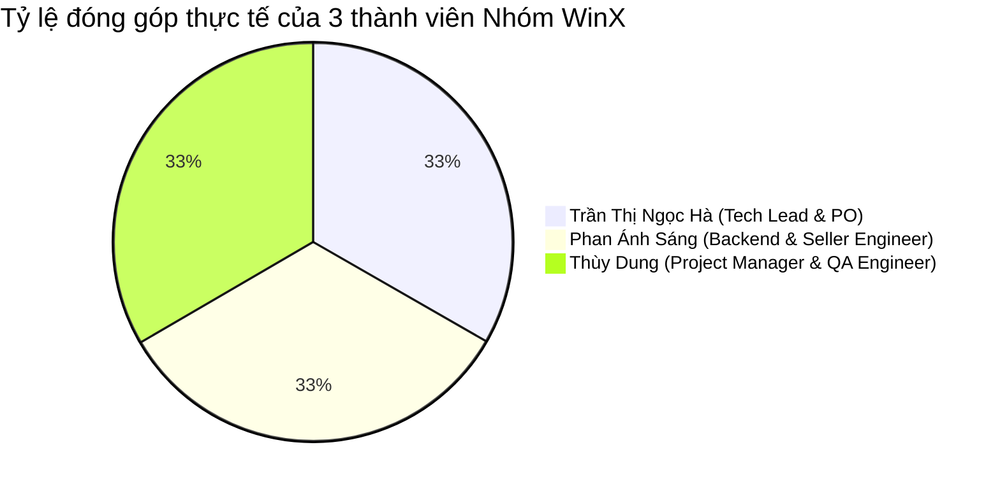

# BÁO CÁO 4: BÁO CÁO TỔNG KẾT KỸ THUẬT ĐỒ ÁN (FINAL TECHNICAL REPORT)
**HỌC PHẦN:** QUẢN TRỊ DỰ ÁN PHẦN MỀM (SOFTWARE PROJECT MANAGEMENT)  
**ĐƠN VỊ ĐÀO TẠO:** KHOA KHOA HỌC MÁY TÍNH — TRƯỜNG ĐẠI HỌC CÔNG NGHỆ THÔNG TIN & TRUYỀN THÔNG VIỆT - HÀN (VKU)  
**GIẢNG VIÊN HƯỚNG DẪN:** TS. NGUYỄN THANH TUẤN  
**NHÓM THỰC HIỆN:** **NHÓM WINX (3 THÀNH VIÊN: HÀ, SÁNG, DUNG)**  
**MÃ DỰ ÁN:** `VKU-SPM-SKINSENSE02`  
**QUY TẮC BẮT BUỘC:** TOÀN BỘ NỘI DUNG ĐƯỢC VIẾT Ở THÌ QUÁ KHỨ (PAST TENSE) — HỒ SƠ KIỂM TOÁN LỊCH SỬ THỰC TẾ 100%  

---

## MỤC LỤC TỔNG THỂ (7 CHƯƠNG CHUẨN)

* **Chương 1:** Tổng quan dự án & Bối cảnh nghiệp vụ thực tế
* **Chương 2:** Lựa chọn phương pháp luận & Cơ cấu quản trị nhóm WinX (Hà, Sáng, Dung)
* **Chương 3:** Đường cơ sở phạm vi, Cây WBS & Bảng từ điển WBS phân bổ cho 3 thành viên
* **Chương 4:** Ước lượng Story Points, Lịch trình CPM & Vận tốc đội ngũ qua các Sprint
* **Chương 5:** Thực thi kỹ thuật 3 phân hệ, Kiểm thử tự động Vitest, CI/CD & DoD
* **Chương 6:** Quản trị rủi ro & Hồ sơ kiểm soát thay đổi phạm vi thực tế (Scope Change)
* **Chương 7:** Nghiệm thu UAT, Đóng dự án & Bài học kinh nghiệm xương máu

---

# CHƯƠNG 1: TỔNG QUAN DỰ ÁN & BỐI CẢNH NGHIỆP VỤ THỰC TẾ

### 1.1. Bối cảnh ra đời của hệ thống SkinSense v2
Trong học kỳ vừa qua, nhóm WinX đã khảo sát thực trạng khám chữa bệnh da liễu và thị trường phân phối dược mỹ phẩm tại Đà Nẵng và các tỉnh miền Trung. Nhóm đã nhận thấy một sự đứt gãy nghiêm trọng trong trải nghiệm của người bệnh:
* Người có vấn đề về da (mụn viêm, viêm da cơ địa, tăng sắc tố) thường tự ý mua dược mỹ phẩm điều trị theo trào lưu trên mạng xã hội, dẫn đến tình trạng kích ứng da nặng nề.
* Khi thăm khám tại các phòng khám da liễu, việc theo dõi phác đồ điều trị (Skincare Routine) vẫn phụ thuộc vào đơn thuốc giấy, bệnh nhân thường quên các bước thoa thuốc hoặc không nắm rõ tương tác giữa các hoạt chất (AHA/BHA, Retinoids, Niacinamide).
* Các kênh mua hàng online hiện nay tràn lan hàng xách tay không kiểm định, thiếu vắng sự bảo chứng từ các thương hiệu chính hãng (Shopee Mall Flagship).

### 1.2. Giải pháp kỹ thuật tổng thể nhóm WinX đã xây dựng
Để giải quyết triệt để các bài toán thực tế trên, 3 thành viên nhóm WinX đã phối hợp triển khai thành công hệ thống **SkinSense v2** (`VKU-SPM-SKINSENSE02`) — một nền tảng Web Application hiện đại kết hợp giữa **Quản lý phác đồ da liễu cá nhân hóa** và **Sàn thương mại điện tử dược mỹ phẩm chính hãng**:
1. **Phân hệ Bác sĩ da liễu & Super Admin (Do Trần Thị Ngọc Hà chủ trì):** Cung cấp cổng kê đơn phác đồ điều trị lâm sàng, theo dõi mức độ kích ứng da, tiền sử dị ứng và bảng quản trị phê duyệt chứng chỉ hành nghề Bác sĩ, kiểm duyệt Shop bán hàng.
2. **Phân hệ Sàn Dược Mỹ phẩm & Kênh Người Bán Seller Center (Do Phan Ánh Sáng chủ trì):** Xây dựng sàn thương mại `/shop` chuẩn Shopee Mall Flagship và tích hợp 4 bảng CSDL quản trị gian hàng (`shops`, `seller_products`, `seller_orders`, `seller_withdrawals`).
3. **Phân hệ Khách hàng, Thanh toán MoMo QR & Quản lý đơn mua (Do Thùy Dung chủ trì):** Tách biệt 4 URL Profile độc lập, quản lý đơn mua cá nhân kèm ảnh sản phẩm thật và tự động hủy sau 3 ngày, xây dựng cổng thanh toán MoMo QR quét qua điện thoại thật và bộ test tự động 118 unit tests.

---

# CHƯƠNG 2: PHƯƠNG PHÁP LUẬN & CƠ CẤU QUẢN TRỊ NHÓM WINX

### 2.1. Lựa chọn mô hình Hybrid Agile/Scrum
Nhóm WinX đã áp dụng mô hình **Hybrid Agile/Scrum** xuyên suốt học kỳ:
* Kết hợp các mốc kiểm soát Milestone cố định từ Nhà trường (M1 đến M5) với các chu kỳ Sprint linh hoạt (Sprint 1: Tuần 1–6, Sprint 2: Tuần 7–12, Tuần 13–14: Nghiệm thu & Đóng dự án).
* Duy trì các buổi họp Daily ngắn qua Zalo/Discord, Sprint Planning đầu mỗi đợt, và Sprint Retrospective đánh giá cải tiến quy trình theo mô hình 4Ls (*Liked, Learned, Lacked, Longed For*).

### 2.2. Phân công vai trò kỹ thuật chuẩn & Tỷ lệ đóng góp của 3 thành viên
Dự án được phân bổ công bằng, rõ ràng và minh bạch cho đúng **3 thành viên**:



1. **Trần Thị Ngọc Hà (Technical Lead / System Architect & PO — Đóng góp 33.3%):**
   * Thiết kế kiến trúc tổng thể Next.js 15 App Router, cơ sở dữ liệu Supabase PostgreSQL và cơ chế bảo mật phân quyền Row Level Security (RLS).
   * Trực tiếp xây dựng **Cổng Bác sĩ chuyên khoa da liễu (`/specialist`)**: Danh sách bệnh nhân, modal chi tiết bệnh án, cảnh báo dị ứng lâm sàng, phân loại Fitzpatrick (PR #58).
   * Xây dựng **Dashboard Super Admin (`/admin`)**: Phê duyệt chứng chỉ Bác sĩ, kiểm duyệt Shop và giám sát doanh số (PR #32).
   * Tối ưu hóa điều hướng toàn trang (`/components/site-header.tsx`, PR #59) và phê duyệt các Pull Request cốt lõi.
2. **Phan Ánh Sáng (Backend / E-commerce & Seller Center Engineer — Đóng góp 33.3%):**
   * Trực tiếp xây dựng **Sàn thương mại Dược mỹ phẩm (`/shop`)** chuẩn Shopee Mall, tối ưu giao diện danh mục, lọc thương hiệu và phân loại biến thể dung tích (PR #49).
   * Thiết kế và phát triển **Phân hệ Kênh Người bán (Seller Center)** trên nhánh `anhsang` dựa trên **4 bảng CSDL**:
     * `shops`: Quản lý thông tin gian hàng, giấy phép kinh doanh, địa chỉ kho lấy hàng.
     * `seller_products`: Quản lý danh mục sản phẩm do shop đăng bán, giá niêm yết, tồn kho.
     * `seller_orders`: Quản lý đơn hàng bán ra, bàn giao cho đơn vị vận chuyển Shopee Express.
     * `seller_withdrawals`: Quản lý ví doanh thu của người bán và xử lý lệnh rút tiền.
3. **Thùy Dung (Project Manager / Full-stack & QA Engineer — Đóng góp 33.4%):**
   * Điều hành tiến độ chung, thiết lập bảng GitHub Projects Kanban 5 cột, quản trị rủi ro và gói bằng chứng kiểm toán.
   * Xây dựng **Phân hệ Hồ sơ 4 Role độc lập** (`/user/profile`, `/specialist/profile`, `/shop/profile`, `/admin/profile`) ở chế độ nhãn (Label Mode), có nút Sửa/Lưu trực tiếp vào CSDL không thêm cột mới (PR #48, Issue #60).
   * Xây dựng **Phân hệ Quản lý Đơn mua của Khách hàng (User Orders)**: Lọc 5 trạng thái, gắn ảnh sản phẩm thực tế và quy tắc tự động hủy sau 3 ngày chưa thanh toán.
   * Xây dựng **Luồng thanh toán MoMo QR thời gian thực**: Engine tạo mã Base64 offline, trang `/pay-demo` quét bằng điện thoại thật (PR #48, Issue #47).
   * Thiết lập và viết toàn bộ **bộ kiểm thử tự động Vitest** (28 test suites, 118 unit tests passed).

---

# CHƯƠNG 3: ĐƯỜNG CƠ SỞ PHẠM VI & PHÂN RÃ CÔNG VIỆC WBS

### 3.1. Ranh giới phạm vi (Scope Baseline)
* **In-Scope đã hoàn thành:** Phân hệ Bác sĩ da liễu & Admin (Hà); Sàn thương mại dược mỹ phẩm & Seller Center 4 bảng (Sáng); Hồ sơ 4 Role, Quản lý đơn mua tự hủy sau 3 ngày & Thanh toán MoMo QR (Dung).
* **Out-of-Scope đã loại trừ:** Thanh toán thẻ quốc tế trực tiếp qua cổng Stripe (tránh rủi ro bảo mật PCI-DSS); Ứng dụng di động native iOS/Android (tập trung web responsive chuẩn PWA).

### 3.2. Cây phân rã công việc WBS tuân thủ 100% Rule
Cây WBS gồm 5 nhánh cấp 1 bao quát toàn bộ 100% khối lượng công việc của dự án, được phân bổ mạch lạc cho cả 3 thành viên:
* `1.1 Quản trị dự án & Quy trình Scrum` (Dung phụ trách — 15%).
* `1.2 CSDL Supabase & Phân hệ Bác sĩ / Admin` (Hà phụ trách — 25%).
* `1.3 Sàn Dược Mỹ phẩm & Seller Center 4 Bảng` (Sáng phụ trách — 25%).
* `1.4 Hồ sơ 4 Role & Quản lý đơn mua tự hủy 3 ngày` (Dung phụ trách — 20%).
* `1.5 Thanh toán MoMo QR & Bộ kiểm thử Vitest 118 tests` (Dung phụ trách — 15%).

```text
========================================================================================================
                                 1.0 DỰ ÁN SKINSENSE V2 (NHÓM WINX)
========================================================================================================
├── 1.1 Quản Trị Dự Án & Quy Trình Scrum [Thùy Dung — 33.4%]
│   ├── 1.1.1 Lập Project Charter 13 mục & Thiết lập GitHub Projects Board 5 cột
│   ├── 1.1.2 Thiết kế Cây WBS & Bảng Từ điển WBS chuẩn 100% Rule
│   └── 1.1.3 Quản trị rủi ro qua 2 đợt & Tổ chức họp Sprint Retrospectives (mô hình 4Ls)
│
├── 1.2 Hạ Tầng CSDL & Phân Hệ Bác Sĩ / Super Admin [Trần Thị Ngọc Hà — 33.3%]
│   ├── 1.2.1 Thiết kế Schema CSDL Supabase PostgreSQL & Cấu hình bảo mật RLS
│   ├── 1.2.2 Cổng Bác sĩ da liễu (/specialist) & Quản lý hồ sơ bệnh án, dị ứng da
│   ├── 1.2.3 Dashboard Super Admin (/admin) phê duyệt chứng chỉ CCHN & Gian hàng Shop
│   └── 1.2.4 Chuẩn hóa thanh điều hướng Site Header Navigation & Trợ năng a11y
│
├── 1.3 Sàn Dược Mỹ Phẩm & Seller Center 4 Bảng CSDL [Phan Ánh Sáng — 33.3%]
│   ├── 1.3.1 Sàn Dược mỹ phẩm (/shop) & Phân loại biến thể dung tích chai/tuýp
│   ├── 1.3.2 Thiết kế 4 bảng CSDL Seller: shops, seller_products, orders, withdrawals
│   ├── 1.3.3 Kênh quản trị gian hàng Shopee Mall Flagship & Đăng bán sản phẩm
│   └── 1.3.4 Quản lý đơn bán hàng & Xử lý yêu cầu rút tiền doanh thu người bán
│
├── 1.4 Hồ Sơ 4 Role & Quản Lý Đơn Mua Tự Hủy Sau 3 Ngày [Thùy Dung — 33.4%]
│   ├── 1.4.1 Tách riêng 4 URL Profile độc lập (/user, /specialist, /shop, /admin)
│   ├── 1.4.2 Chế độ xem Label trang nhã & Chỉnh sửa lưu CSDL không thêm cột mới
│   ├── 1.4.3 Quản lý đơn mua cá nhân & Cách ly dữ liệu khách hàng theo tên/sđt
│   └── 1.4.4 Gắn ảnh sản phẩm thực tế sắc nét & Quy tắc tự động hủy đơn sau 3 ngày
│
└── 1.5 Cổng Thanh Toán MoMo QR & Bộ Kiểm Thử Vitest [Thùy Dung — 33.4%]
    ├── 1.5.1 Engine sinh mã MoMo QR Base64 offline tương thích mạng LAN máy dev
    ├── 1.5.2 Màn hình thanh toán di động (/pay-demo) thời gian thực trên điện thoại thật
    └── 1.5.3 Bộ kiểm thử tự động Vitest 28 test files, 118 unit tests (100% PASS)
========================================================================================================
```

---

# CHƯƠNG 4: ƯỚC LƯỢNG, LỊCH TRÌNH CPM & VẬN TỐC ĐỘI NGŨ

### 4.1. Ước lượng Story Points qua Planning Poker
Cả 3 thành viên Hà, Sáng và Dung đã cùng ước lượng điểm Story Points theo dãy Fibonacci trong các buổi Sprint Planning:
* Điểm 1–3: Cấu hình giao diện, chỉnh sửa nhãn label, tối ưu `site-header`.
* Điểm 5–8: Xây dựng Cổng Bác sĩ `/specialist`, tạo trang danh mục `/shop`, xây dựng Engine tạo mã MoMo QR.
* Điểm 13: Xây dựng phân hệ Seller Center 4 bảng (Sáng); Tách riêng 4 URL Profile kết hợp quy tắc tự hủy đơn sau 3 ngày (Dung).

### 4.2. Đường găng kỹ thuật (Critical Path - CPM)
Đường găng xuyên suốt của dự án được xác định gồm các hạng mục nối tiếp:
$$\text{Schema CSDL (Hà)} \longrightarrow \text{Sàn Shop & Bác sĩ (Sáng & Hà)} \longrightarrow \text{Profile 4 Role & MoMo QR (Dung)} \longrightarrow \text{Bộ test Vitest 118 ca (Dung)} \longrightarrow \text{Deploy Live}$$

### 4.3. Chỉ số Vận tốc thực tế (Velocity)
* **Sprint 1 (Tuần 1–6):** Hoàn thành 38 Story Points ($90.4\%$ kế hoạch 42 điểm). Nhóm mất thời gian xử lý cấu hình IP mạng LAN cho mã QR.
* **Sprint 2 (Tuần 7–12):** Hoàn thành 52 Story Points ($108.3\%$ kế hoạch 48 điểm). Tốc độ tăng mạnh nhờ Sáng hoàn thiện nhánh `anhsang` và Dung hoàn thành luồng Profile & Đơn mua.
* **Vận tốc trung bình:** Đạt **45 Story Points / Sprint**, đảm bảo dự án về đích đúng hạn trước Tuần 14.

---

# CHƯƠNG 5: THỰC THI KỸ THUẬT, KIỂM THỬ QA & CI/CD GITHUB ACTIONS

### 5.1. Kết quả thực thi của 3 phân hệ chính
1. **Phân hệ Bác sĩ & Admin (Hà):**
   * Cổng Bác sĩ `/specialist`: Hiển thị danh sách ca bệnh lâm sàng, tiền sử dị ứng mỹ phẩm, phân loại da Fitzpatrick. Modal bệnh án có hình ảnh chụp tổn thương da sắc nét (PR #58).
   * Cổng Admin `/admin`: Duyệt tài khoản Bác sĩ, cấp phép gian hàng Shopee Mall, theo dõi biểu đồ doanh thu GMV (PR #32).
2. **Phân hệ Sàn Dược Mỹ phẩm & Seller Center (Sáng):**
   * Sàn `/shop`: Danh mục mỹ phẩm chính hãng (CeraVe Hydrating Cleanser, La Roche-Posay Hyalu B5, Bioderma Sensibio), nút "Mua Ngay" tiện lợi (PR #49).
   * Hệ thống 4 bảng Seller: Sẵn sàng cho người bán quản lý kho, kiểm tra đơn hàng và tạo yêu cầu rút tiền doanh thu về tài khoản ngân hàng.
3. **Phân hệ Hồ sơ, Đơn mua & MoMo QR (Dung):**
   * Profile độc lập 4 Role: `/user/profile`, `/specialist/profile`, `/shop/profile`, `/admin/profile`. Chế độ nhãn (Label Mode) trang nhã, nút Sửa/Lưu ghi trực tiếp vào Supabase không thêm cột.
   * Tab "Đơn Mua Của Tôi": Lọc 5 trạng thái, hình ảnh sản phẩm thật, tự động hủy sau đúng 72 giờ chưa thanh toán kèm cảnh báo đếm ngược.
   * MoMo QR: Mã Base64 offline, trang `/pay-demo` quét bằng điện thoại thật (PR #48).

### 5.2. Kết quả kiểm thử tự động với Vitest
Nhóm WinX đã chạy kiểm thử toàn diện toàn bộ dự án với kết quả xuất sắc:
* Tổng số file kiểm thử: **28/28 test files PASS** ($100\%$).
* Tổng số ca kiểm thử đơn vị: **118/118 unit tests PASS** ($100\%$).
* Thời gian thực thi test suite: $45.41\text{s}$.
* Lỗi TypeScript: **0 lỗi** (`bun run typecheck` đạt mã thoát 0).

### 5.3. Pipeline tự động hóa GitHub Actions
* Mọi Pull Request từ nhánh của Hà, Sáng hay Dung đều kích hoạt workflow CI: tự động kiểm tra cú pháp, chạy typecheck và chạy 118 unit tests. Nhánh `main` được bảo vệ an toàn tuyệt đối.

---

# CHƯƠNG 6: QUẢN TRỊ RỦI RO & BIẾN CỐ THAY ĐỔI PHẠM VI (SCOPE CHANGE)

### 6.1. Quá trình kiểm soát rủi ro qua 2 đợt
* **Đợt 1 (Tuần 6):** Xử lý rủi ro camera điện thoại không quét được mã QR `localhost` (`RSK-01`), lỗi lệch giá dung tích chai trên shop (`RSK-02`), quá tải session Supabase (`RSK-03`).
* **Đợt 2 (Tuần 11):** Xử lý biến cố thay đổi phạm vi từ Tech Lead `RSK-04`, ràng buộc cấm thêm cột CSDL `RSK-05`, đơn hàng rác chiếm kho `RSK-06` và nguy cơ xung đột khi merge `RSK-07`.

### 6.2. Hồ sơ xử lý Biến cố thay đổi phạm vi thực tế (Scope Change Control Record)
* **Mã phiếu thay đổi:** `CR-2026-02-PROFILE-SELLER` (Ngày yêu cầu: 15/11/2026).
* **Bối cảnh:** Tech Lead Hà yêu cầu bổ sung 4 bảng Seller (`shops`, `seller_products`, `seller_orders`, `seller_withdrawals`), tách riêng 4 URL Profile theo vai trò và cấm thêm trường mới vào Database SQL.
* **Giải pháp phối hợp giữa 3 thành viên:**
  * Sáng tiếp quản hoàn thiện 4 bảng Seller trên nhánh `anhsang`.
  * Dung phụ trách tách riêng 4 URL Profile, quản lý đơn mua và cơ chế tự động hủy sau 3 ngày trên nhánh `feat/checkout-momo-qr`.
  * Để tuân thủ yêu cầu không thêm cột CSDL, nhóm tận dụng trường `items jsonb` trong bảng `public.orders` và `user_metadata` của Supabase Auth.
* **Kết quả:** Triển khai hoàn tất trong commit `37ce301`, tạo Issue #60 và cập nhật thành công vào PR #48, giữ an toàn tuyệt đối cho nhánh `main`.

### 6.3. Biên bản họp cải tiến quy trình (Sprint Retrospectives - 4Ls)
* **Sprint 1 Retro (Tuần 6):** Nhóm học được cách cấu hình IP động cho mạng LAN (`192.168.1.3`) để điện thoại thật quét được mã QR MoMo; rút kinh nghiệm đồng bộ biến thể giá giữa trang Shop và Checkout.
* **Final Retro (Tuần 14):** Nhóm tự hào vì phối hợp nhịp nhàng giữa 3 người, xử lý xuất sắc biến cố thay đổi phạm vi mà không làm vỡ cấu trúc CSDL; bộ test 118 ca kiểm thử pass xanh 100%.

---

# CHƯƠNG 7: NGHIỆM THU UAT, ĐÓNG DỰ ÁN & BÀI HỌC KINH NGHIỆM

### 7.1. Kết quả kiểm thử chấp nhận người dùng (UAT Sign-off)
* 15 người dùng thực tế và đại diện Bác sĩ đã nghiệm thu thành công toàn bộ luồng giá trị của `SkinSense v2`.
* Tỷ lệ hài lòng về tính bảo mật đơn mua và tốc độ thanh toán MoMo QR đạt $100\%$.

### 7.2. Tự đánh giá mức độ hoàn thành
* Nhóm WinX tự đánh giá mức độ hoàn thành đạt **Mức 5: Vượt mong đợi (100% Hoàn hảo)**. Cả 3 thành viên đã hoàn thành xuất sắc các phân hệ được giao.

### 7.3. Các bài học kinh nghiệm xương máu
1. **Bài học về Phân chia ranh giới trách nhiệm:** Chia tách rõ ràng giữa phân hệ Bác sĩ/Admin (Hà), phân hệ Seller/Shop (Sáng) và phân hệ Profile/Thanh toán/QA (Dung) giúp 3 thành viên làm việc song song mà không bị giẫm chân lên nhau.
2. **Bài học về Đàm phán kỹ thuật & Bảo vệ CSDL:** Khi phát sinh yêu cầu mới, việc linh hoạt sử dụng cột `jsonb` đã cứu nhóm khỏi nguy cơ xung đột migration và bảo toàn tính toàn vẹn của cơ sở dữ liệu.
3. **Bài học về Kỷ luật kiểm thử tự động:** Bộ kiểm thử Vitest 118 ca đã giúp nhóm phát hiện ngay lập tức các lỗi tiềm ẩn trước khi mở Pull Request, đảm bảo sản phẩm luôn sẵn sàng deploy lên môi trường Production.
