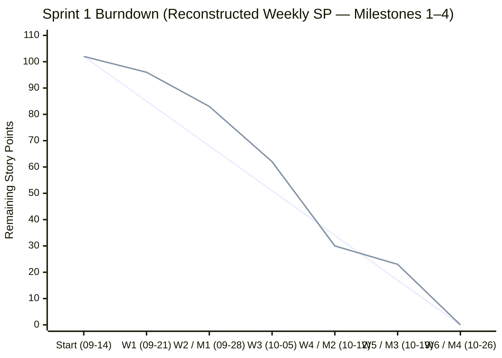

# Sprint 1 Plan, Backlog, Burndown, Review & Retrospective

- **Sprint**: Sprint 1 (Weeks 1–6)
- **Duration**: **2026-09-14 → 2026-10-26**
- **GitHub Milestones**: Milestone 1 (`due: 2026-09-28`), Milestone 2 (`due: 2026-10-12`), Milestone 3 (`due: 2026-10-19`), Milestone 4 (`due: 2026-10-26`, Release `v1.0.0`)
- **Primary Author & Sole Owner (Sprint 1)**: **Trần Thị Ngọc Hà** (`@Tranthingocha-teo`, `hattn.23itb@vku.udn.vn`) — authored **100%** of Sprint 1 Issues (`#1–#23`, **102 / 102 Story Points**) and the first repository commits (`29b6de5` through `d332492`).

> **Academic Honesty & Board Reconstruction Note**:
> Sprint 1 was executed solo by `@Tranthingocha-teo` while establishing the monorepo and shipping `v1.0.0`. Commits were pushed in stabilized milestones (`37` commits recorded on `2026-10-24`, leading to release tag `v1.0.0` at commit `d332492`). Accordingly, Sprint 1 Kanban transitions (`Backlog` → `Ready` → `In Progress` → `In Review` → `Done`) and the weekly Burndown trajectory below are **retroactively reconstructed** from GitHub Milestones 1–4, Issue metadata, and git tag timestamps, rather than claiming continuous daily board drags during Weeks 1–5.

---

## 1. Sprint 1 Goal

Build, verify, and ship **SkinSense v1.0.0** end-to-end across Web (**Next.js 16**) and Mobile (**Expo Android**) sharing deterministic domain math (**`@skinsense/domain`**) and design tokens (**`@skinsense/tokens`**):
- Establish monorepo tooling, shared domain engine (redness index, facial zones, geometry), and Postgres/Drizzle schema.
- Deliver guided camera capture with on-device MediaPipe/TFLite quality checks, spot marking canvas, multi-date skin trend analytics, customizable daily routine streaks, and Google OAuth / demo mode.
- Ship secretless CI, Handoff Audit docs, Vercel Web deployment, Supabase Cloud DB + Keep-Alive cron, Lighthouse audit, Android physical QA, and signed Android APK `v1.0.0`.

---

## 2. Sprint 1 Backlog, Story Points & Assignees (`23 Issues` / `102 SP`)

| Issue | Milestone | WBS / Title | SP | Assignee | First Commit / Ref | Status | Completed |
|---|---|---|---|---|---|---|---|
| `#1` | M1 (`09-28`) | `feat(setup)`: Monorepo Foundation, Build Tooling & Specifications | 3 | `@Tranthingocha-teo` | `29b6de5` | `Done` | 2026-09-21 (batch `10-24`) |
| `#2` | M1 (`09-28`) | `feat(tokens)`: Shared Design Tokens & Theme Foundation | 3 | `@Tranthingocha-teo` | `f97d710` | `Done` | 2026-09-23 (batch `10-24`) |
| `#3` | M1 (`09-28`) | `feat(domain)`: Core Domain Engine - Redness, Zones & Geometry Algorithms | 8 | `@Tranthingocha-teo` | `59586f2` | `Done` | 2026-09-26 (batch `10-24`) |
| `#4` | M1 (`09-28`) | `feat(database)`: Schema, Drizzle Migrations & Supabase Functions | 5 | `@Tranthingocha-teo` | `8c8769a` | `Done` | 2026-09-28 (batch `10-24`) |
| `#5` | M2 (`10-12`) | `feat(routine)`: Daily Routine Checklist & Streak Tracking (Web & Mobile) | 5 | `@Tranthingocha-teo` | `ca4161c` | `Done` | 2026-10-02 (batch `10-24`) |
| `#6` | M2 (`10-12`) | `feat(capture)`: Guided Camera Capture Engine & Quality Validation | 8 | `@Tranthingocha-teo` | `f5d33ab` | `Done` | 2026-10-04 (batch `10-24`) |
| `#7` | M2 (`10-12`) | `feat(spots)`: Interactive Acne & Spot Marking Module (Web & Mobile) | 8 | `@Tranthingocha-teo` | `a262802` | `Done` | 2026-10-06 (batch `10-24`) |
| `#8` | M2 (`10-12`) | `feat(analytics)`: Skin Trends Analytics & Multi-Date Progress Comparison | 5 | `@Tranthingocha-teo` | `d511bc1` | `Done` | 2026-10-08 (batch `10-24`) |
| `#9` | M2 (`10-12`) | `feat(auth)`: Authentication, Settings & Backend-Free Demo Mode | 5 | `@Tranthingocha-teo` | `b8a4576` | `Done` | 2026-10-09 (batch `10-24`) |
| `#10` | M2 (`10-12`) | `feat(shell)`: Application Shell, Navigation & "Hôm Nay" Dashboard | 3 | `@Tranthingocha-teo` | `e75ecfb` | `Done` | 2026-10-10 (batch `10-24`) |
| `#11` | M2 (`10-12`) | `feat(features)`: Photo Detail Notes, Tags, Reminders & User Feedback | 3 | `@Tranthingocha-teo` | `4bfbc56` | `Done` | 2026-10-11 (batch `10-24`) |
| `#12` | M2 (`10-12`) | `feat(web)`: Public Landing, 3D Particle Face Stage & UI Component Library | 8 | `@Tranthingocha-teo` | `f4eb8b0` | `Done` | 2026-10-12 (batch `10-24`) |
| `#13` | M2 (`10-12`) | `feat(mobile)`: Mobile Architecture, Native UI Kit, Fonts & Build Configuration | 8 | `@Tranthingocha-teo` | `9f860e5` | `Done` | 2026-10-12 (batch `10-24`) |
| `#14` | M3 (`10-19`) | `ci(test)`: GitHub Actions CI Pipeline & Automated Test Suites | 5 | `@Tranthingocha-teo` | `e7c70ad` | `Done` | 2026-10-17 (batch `10-24`) |
| `#15` | M3 (`10-19`) | `docs(handoff)`: Project Audit Records, Technical Specifications & Final Delivery | 2 | `@Tranthingocha-teo` | `d255bb4` | `Done` | 2026-10-19 (batch `10-24`) |
| `#16` | M4 (`10-26`) | `[Launch 1/8]` Provision Supabase Backend & Apply Drizzle Migrations | 3 | `@Tranthingocha-teo` | `M4 Launch` | `Done` | 2026-10-24 |
| `#17` | M4 (`10-26`) | `[Launch 2/8]` Configure Google Cloud OAuth 2.0 (Web & Android Clients) | 3 | `@Tranthingocha-teo` | `M4 Launch` | `Done` | 2026-10-24 |
| `#18` | M4 (`10-26`) | `[Launch 3/8]` Deploy Web Application to Vercel | 3 | `@Tranthingocha-teo` | `M4 Launch` | `Done` | 2026-10-24 |
| `#19` | M4 (`10-26`) | `[Launch 4/8]` Setup Supabase Keep-Alive Cron | 2 | `@Tranthingocha-teo` | `M4 Launch` | `Done` | 2026-10-24 |
| `#20` | M4 (`10-26`) | `[Launch 5/8]` Setup EAS Credentials, Release Keystore & Build Signed APK v1.0.0 | 5 | `@Tranthingocha-teo` | `d332492` | `Done` | 2026-10-24 |
| `#21` | M4 (`10-26`) | `[Launch 6/8]` Execute Android Manual QA on Physical Hardware | 3 | `@Tranthingocha-teo` | `docs/qa-android-checklist.md` | `Done` | 2026-10-24 |
| `#22` | M4 (`10-26`) | `[Launch 7/8]` Run Production Lighthouse Audit on Deployed Web App | 2 | `@Tranthingocha-teo` | `docs/lighthouse-audit.md` | `Done` | 2026-10-24 |
| `#23` | M4 (`10-26`) | `[Launch 8/8]` Publish Release v1.0.0 on GitHub Releases | 2 | `@Tranthingocha-teo` | Tag `v1.0.0` | `Done` | 2026-10-24 |

- **Total Planned Story Points**: `102 SP` (`M1: 19 SP`, `M2: 53 SP`, `M3: 7 SP`, `M4: 23 SP`)
- **Total Completed**: **`102 / 102 SP (100%)`** by `@Tranthingocha-teo`

---

## 3. Board State History & Weekly Burndown (Reconstructed)

### Weekly Burndown Table (`102 SP` Total)

| Timeline Checkpoint | Milestone Closed | Issues Closed in Period | Ideal Remaining SP | Reconstructed Actual Remaining SP | Key Events |
|---|---|---|---|---|---|
| **Start (`2026-09-14`, W1 Start)** | — | — | `102` | `102` | Sprint 1 Kickoff, WBS scoping (`#1–#23`) |
| **End W1 (`2026-09-21`)** | — | `#1–#2` moved `In Progress` → `Done` (`6 SP`) | `85` | `96` | Monorepo & `@skinsense/tokens` stabilized |
| **End W2 (`2026-09-28`)** | Milestone 1 | `#3–#4` closed (`13 SP`; cum. `19 SP`) | `68` | `83` | Domain math (`#3`) & Drizzle schema (`#4`) done |
| **End W3 (`2026-10-05`)** | — | `#5–#7` closed (`21 SP`; cum. `40 SP`) | `51` | `62` | Routine, Guided Camera & Spot Marking done |
| **End W4 (`2026-10-12`)** | Milestone 2 | `#8–#13` closed (`32 SP`; cum. `72 SP`) | `34` | `30` | Analytics, Auth/Demo, Web 3D Hero & Mobile Kit done |
| **End W5 (`2026-10-19`)** | Milestone 3 | `#14–#15` closed (`7 SP`; cum. `79 SP`) | `17` | `23` | GitHub Actions CI (`typecheck` + `test`) & Audit docs |
| **End W6 (`2026-10-26` / Git `10-24`)** | Milestone 4 | `#16–#23` closed (`23 SP`; cum. `102 SP`) | `0` | `0` | Cloud Supabase, OAuth, Vercel, Signed APK `v1.0.0`, QA |

> *Repository Timestamp Reality*: Because git commits were squashed/batched onto GitHub on `2026-10-24` (`37` commits), all 23 Sprint 1 Issues officially carry GitHub close date `2026-10-24`. Weekly remaining SP above reflects reconstructed milestone burn-down rather than literal live GitHub Project #2 clicks during Weeks 1–5.

### Sprint 1 Burndown Chart

*(First line = Ideal linear burn `102 → 0`; Second line = Reconstructed Actual burn `102 → 96 → 83 → 62 → 30 → 23 → 0`.)*

---

## 4. Sprint 1 Review (Delivered Increment — `v1.0.0`)

1. **Cross-Platform Monorepo**: Turborepo workspaces (`apps/web`, `apps/mobile`, `packages/domain`, `packages/tokens`, `packages/tsconfig`).
2. **Dermatology Tracking Core**:
   - Facial zone segmentation & redness index calculation (`@skinsense/domain`).
   - On-device guided camera capture using `react-native-vision-camera` + `react-native-fast-tflite` with Nitro patch (`patches/react-native-vision-camera-face-detector@2.1.0.patch`).
   - Interactive acne/spot marker canvas & multi-date photo comparison.
   - Daily AM/PM routine checklist with streak counter.
3. **Production Deployment & Quality**:
   - Web app deployed on Vercel (`apps/web`), Mobile APK `v1.0.0` packaged (`d332492`), Supabase DB live with Keep-Alive cron, Google OAuth + Backend-Free Demo Mode (`#9`).
   - Automated unit test suites active across domain, web, and mobile (`#14`), plus physical Android QA (`docs/qa-android-checklist.md`) and Lighthouse audit (`docs/lighthouse-audit.md`).

---

## 5. Sprint 1 Retrospective & Week 6 Risk Summary

### What Went Well
- Shared TypeScript packages eliminated duplicate business logic across Web and Mobile.
- Backend-free demo mode allowed immediate local testing and secretless GitHub Actions CI execution.
- Clear Architecture Decision Records (`docs/adr/0001`..`0004`) kept camera landmarks, DB schema, redness thresholds, and routine customization decoupled.

### What Needed Improvement (Action Items for Sprint 2)
1. **Granular Git & Board Cadence (`R03`)**: Avoid batching 37 commits on a single day; enforce feature branches + linked Issues (`Closes #<id>`).
2. **CI Gate Coverage (`R04` → Sprint 2 `R01`)**: `ci.yml` only ran `typecheck` and `test`; `bun run lint` and `bun run build` were missing, leaving potential ESLint errors undetected.
3. **Mobile CI Automation (`R02`)**: APK `v1.0.0` was built manually via EAS CLI (`#20`); carried over to Sprint 2 as `Issue #29` for GitHub Actions automation.
4. **Team Collaboration & Code Review**: Enable collaborator onboarding (`#30`) and repository PR Ruleset before expanding Sprint 2 into multi-role clinical & e-commerce modules.

See Week 6 Risk Snapshot (`R01–R05`) and Week 11 evolutions (`R01–R06`) in [`docs/governance/RISK_REGISTER.md`](../governance/RISK_REGISTER.md).
