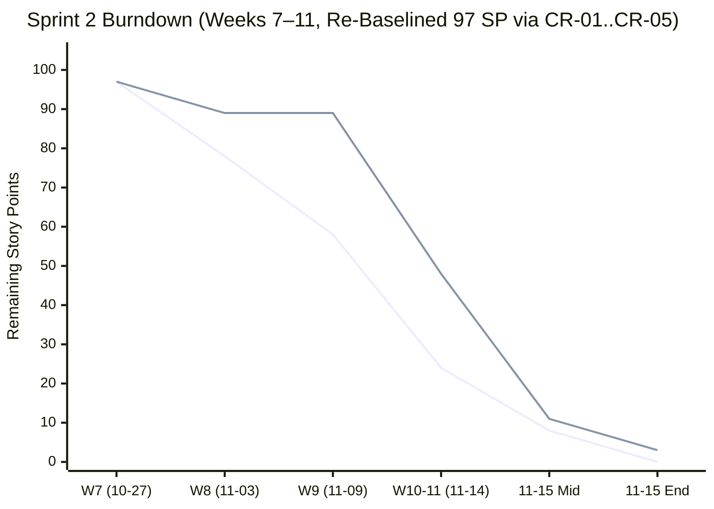

# Sprint 2 Plan, Backlog, Burndown, Review & Final Retrospective

- **Sprint**: Sprint 2 (Weeks 7–11)
- **Duration**: **2026-10-27 → 2026-11-15**
- **GitHub Milestone**: `Milestone 6: Sprint 2 - Multi-Role Platform, Shopee Mall, Media & QA` (`due: 2026-11-15`)
- **Change Requests Driving Sprint 2**: `CR-01`, `CR-02`, `CR-03`, `CR-04`, `CR-05` ([`CHANGE_REQUESTS.md`](../governance/CHANGE_REQUESTS.md))
- **First Author & Primary Builder (Sprint 2)**: **Trần Thị Ngọc Hà** (`@Tranthingocha-teo`)

---

## 1. Sprint 2 Goal

Evolve SkinSense from a single-user diary (`v1.0.0`) into a **4-role multi-tenant dermatology & Shopee Mall skincare platform** (`customer`, `shop`, `specialist`, `admin`) backed by real Supabase PostgreSQL persistence, doctor prescription sync, shop/admin moderation, server-signed device/camera product media uploads, comprehensive automated test suites, full CI enforcement (`lint`, `typecheck`, `test`, `build`), and auditable Scrum/Risk governance.

---

## 2. Contribution Timeline & Authorship Verification (Honest Git/PR Record)

Sprint 2 contributions occurred chronologically in two waves, with **`@Tranthingocha-teo` authoring the FIRST Sprint 2 baseline (`#75`) and delivering the majority of features, APIs, security isolation, media upload, testing, CI, and governance (`63 SP` sole + `19 SP` co-owned across `35` PRs)**:

1. **Wave 1 — First Sprint 2 Core Built by `@Tranthingocha-teo` (`2026-10-25` → `2026-11-03`, BEFORE Teammate PRs)**:
   - `2026-10-25` (`ae10973`, `e36736c`): Built 3-tier marketplace foundation & boutique admin store management.
   - `2026-10-26` (`f7dfe33`, `7c1219c`, `9f37d6c`, `042e9bf`): Implemented 4-role authentication, isolated role workstations, multi-vendor shop approval flow, and TFLite signature alignment.
   - `2026-11-03` (`0e7ea5f`, `4d4dc75`, `767442d`, `6059e3d`, `65f0e96`, `ac70fab`): Added `CODEOWNERS`, enabled repo Ruleset `"Only Owner Merge"`, shipped editorial luxury routine, email/password + 1-click role cards, and onboarded teammates (`Issue #30`).
2. **Wave 2 — Team UI Shells & Hà's Full-Stack Production Hardening (`2026-11-09` → `2026-11-15`)**:
   - `@thuyydung` delivered UI layouts via `PR #32` (`11-09`), `PR #34`, `PR #36`, `PR #48` (`#31, #33, #35, #47, #60`).
   - `@dinhthianhsang` submitted Seller UI `PR #49` (`OPEN`, CI failing) and landed Seller Payment UI via `PR #61` (`#83`).
   - `@Tranthingocha-teo` built Supabase production schema/seed & OAuth (`PR #37–#39`), Admin 4-role & moderation APIs (`PR #40–#43`), Specialist Clinical Cases & allergy alert sync (`PR #44, #54, #56, #58`), Multi-tenant Routine isolation (`PR #45–#46, #62–#63`), Shop admin approval gate & shop-name isolation (`PR #64–#66`), Server-signed Cloudinary device/camera uploader (`PR #67–#74`), API/A11y/SafeProductImage test suites (`PR #50–#53, #55, #57, #59`), resolved all 69 Web ESLint errors + hardened CI/Mobile Preview workflows + PR/Issue templates (`PR #86`), and authored Scrum/Risk governance (`PR #87`).

### Sprint 2 Effort Distribution (`18 Issues` / `97 SP`)

| Contributor | Sole Issues (Count / SP) | Co-Owned Issues (Count / SP) | Total Issues Involved | Merged PRs |
|---|---|---|---|---|
| **`@Tranthingocha-teo`** *(Tech Lead / First Author)* | **10 Issues** (`#75–#82, #84, #85`) = **63 SP** *(64.9%)* | **5 Issues** (`#29, #30, #31, #33, #35`) = **19 SP** *(19.6%)* | **15 / 18 Issues** (`82 / 97 SP`) | **35 PRs** (`#37–#46`, `#50–#59`, `#62–#74`, `#86`, `#87`) |
| **`@thuyydung`** *(Collaborator)* | **2 Issues** (`#47, #60`) = **10 SP** *(10.3%)* | **4 Issues** (`#30, #31, #33, #35`) = **16 SP** | **6 / 18 Issues** | **4 PRs** (`#32, #34, #36, #48`) |
| **`@dinhthianhsang`** *(Collaborator)* | **1 Issue** (`#83`) = **5 SP** *(5.2%)* | **2 Issues** (`#29, #30`) = **4 SP** | **3 / 18 Issues** | **1 Merged** (`#61`), **1 Open** (`#49`) |

---

## 3. Sprint 2 Backlog, Story Points, Assignees & Linked PRs (`18 Issues` / `97 SP`)

| Issue | CR Ref | Title | SP | Assignee(s) | PR(s) | Final Status | Date Closed |
|---|---|---|---|---|---|---|---|
| `#75` | `CR-01, CR-02` | `feat(core-s2)`: 4-Role Auth Foundation, Early Marketplace & Editorial Routine *(First Sprint 2 Baseline)* | 8 | `@Tranthingocha-teo` | Direct early Sprint 2 (`ae10973`..`ac70fab`) | `Done` | 2026-11-03 (tracked `11-15`) |
| `#30` | — | `team(onboarding)`: Welcome `@dinhthianhsang` & `@thuyydung` to Team Roadmap | 1 | `@Tranthingocha-teo`, `@thuyydung`, `@dinhthianhsang` | Onboarding setup | `Done` | 2026-11-15 |
| `#31` | `CR-01` | `feat(admin)`: 4-Role User Management & Shop Moderation Dashboard | 5 | `@Tranthingocha-teo`, `@thuyydung` | `PR #32`, `PR #43` | `Done` | 2026-11-14 |
| `#33` | `CR-03` | `feat(specialist)`: Doctor Dermatology Portal, Case Management & Doctor Profile | 5 | `@Tranthingocha-teo`, `@thuyydung` | `PR #34`, `PR #44` | `Done` | 2026-11-14 |
| `#35` | `CR-02` | `feat(shop)`: Shopee Mall Product Selling & Storefront Portal | 5 | `@Tranthingocha-teo`, `@thuyydung` | `PR #36`, `PR #64–#66` | `Done` | 2026-11-14 |
| `#47` | `CR-02` | `feat(checkout)`: Shopee Mall Order Checkout & MoMo QR Payment Flow | 5 | `@thuyydung` | `PR #48` | `Done` | 2026-11-15 |
| `#60` | `CR-01` | `feat(profile)`: Separate 4-Role Profile Views & User Order History | 5 | `@thuyydung` | `PR #48` | `Done` | 2026-11-15 |
| `#76` | `CR-01` | `feat(db,auth)`: Supabase PostgreSQL Seed, Passwordless Google OAuth & Super Admin Guard | 8 | `@Tranthingocha-teo` | `PR #37, #38, #39` | `Done` | 2026-11-15 |
| `#77` | `CR-01, CR-02` | `feat(admin-api)`: Supabase APIs for 4-Role Users, Specialists, Products & Orders | 8 | `@Tranthingocha-teo` | `PR #40, #41, #42, #43` | `Done` | 2026-11-15 |
| `#78` | `CR-03` | `feat(specialist)`: Clinical Cases API, Prescription Sync Helper & Doctor Validation | 5 | `@Tranthingocha-teo` | `PR #44, #54, #56, #58` | `Done` | 2026-11-15 |
| `#79` | `CR-03` | `feat(routine)`: Morning/Evening Split Routine Sync & Strict Per-User Isolation | 5 | `@Tranthingocha-teo` | `PR #45, #46, #62, #63` | `Done` | 2026-11-15 |
| `#80` | `CR-02` | `feat(shop-security)`: Admin Shop Approval Gate, Product Moderation & Shop Name Isolation | 8 | `@Tranthingocha-teo` | `PR #64, #65, #66` | `Done` | 2026-11-15 |
| `#81` | `CR-04` | `feat(media,shop)`: Signed Server Image Upload, Device/Camera Uploader & Shop/Checkout Flow | 8 | `@Tranthingocha-teo` | `PR #67–#74` | `Done` | 2026-11-15 |
| `#82` | `CR-03` | `test(qa)`: Multi-Tenant API Test Suites, SafeProductImage & Navigation Accessibility | 5 | `@Tranthingocha-teo` | `PR #50–#53, #55, #57, #59` | `Done` | 2026-11-15 |
| `#83` | `CR-02` | `feat(seller)`: Shopee Seller Payment UI & Seller Center Revision Review | 5 | `@dinhthianhsang` | `PR #61` (merged), `PR #49` (open) | `Done` (`PR #49` active) | 2026-11-15 |
| `#84` | `CR-05` | `ci(quality)`: Fix All 69 Web ESLint Errors, Enforce `lint` & `build` in CI, Add Templates | 5 | `@Tranthingocha-teo` | `PR #86` | `Done` | 2026-11-15 |
| `#85` | `CR-05` | `docs(governance)`: Sprint 1 & 2 Plans, Burndowns, Reviews, Retros, Dynamic Risk Register & Traceability | 3 | `@Tranthingocha-teo` | `PR #87` | `Done` *(upon #87 merge)* | 2026-11-15 |
| `#29` | `CR-05` | `ci(mobile)`: Automated EAS Preview Build Pipeline on GitHub Actions | 3 | `@Tranthingocha-teo`, `@dinhthianhsang` | `PR #86` (`mobile-preview.yml`) | **`In Review`** *(Open)* | Awaits `EXPO_TOKEN` |

- **Completed at Sprint 2 End**: **`94 / 97 SP` (`96.9%`)** across `17 / 18` Issues.
- **Open Carry-Over in `In Review`**: **`#29` (`3 SP`)** — `.github/workflows/mobile-preview.yml` runs cleanly (`Run 43703807921` green: mobile lint, typecheck, 149 Jest tests, Expo public config); live EAS Android build job skips cleanly until `EXPO_TOKEN` secret is provisioned.
- **Open PR Tracked in `In Progress`**: **`PR #49`** (`@dinhthianhsang`) — failed CI Run `43632413725` (`4` TS errors) and received formal `REQUEST_CHANGES` review from `@Tranthingocha-teo` (superseded by `PR #61` & `PR #64–#74`).

---

## 4. Board State Transitions & Sprint 2 Burndown (`97 SP` Re-Baselined Scope)

### Board State Transitions Log (Evidence from PR/Review/Issue History)

| Date | Board Movement Observed | Items |
|---|---|---|
| `2026-10-25..11-03` | `Ready` → `In Progress` → `Done` | Early Sprint 2 foundation (`#75`, `8 SP`); repo Ruleset & `CODEOWNERS` activated (`11-03`); `#30` opened |
| `2026-11-09` | `Ready` → `In Progress` → `In Review` | `@thuyydung` opened Admin UI (`PR #32` for `#31`) |
| `2026-11-14 (AM–PM)` | `In Progress` → `In Review` → `Done` | `#31, #33, #35` UI & APIs merged (`PR #32, #34, #36, #37–#46, #50–#59`); `#76, #77, #78, #79, #82` completed; `PR #49` opened (`In Progress` after CI fail) |
| `2026-11-15 (AM)` | `In Review` → `Done` | `#47, #60` (`PR #48`), `#83` (`PR #61`), `#80` (`PR #64–#66`), `#81` (`PR #67–#74`), `#30` closed |
| `2026-11-15 (PM)` | `In Progress` → `In Review` → `Done` / `In Review` | `#84` (`PR #86`, CI Run `43703807949` GREEN) moved `Done`; `#29` moved to `In Review` (`mobile-preview.yml` green, awaits `EXPO_TOKEN`); `PR #49` updated with `CHANGES_REQUESTED`; `#85` (`PR #87`) completes docs |

### Weekly / Checkpoint Burndown Table (`97 SP` Total Sprint 2 Scope)

| Checkpoint | Re-Baselined Ideal Remaining SP | Actual Remaining SP | Completed Items |
|---|---|---|---|
| `2026-10-27` (W7 Start — CR re-baseline) | `97` | `97` | `#75` (`8 SP`) in progress from `10-25..26` |
| `2026-11-03` (W8 — Ruleset + `#75` complete) | `78` | `89` | `#75` (`8 SP`) complete |
| `2026-11-09` (W9 — Team integration start) | `58` | `89` | `PR #32` (`#31`) in review |
| `2026-11-14` (W10/W11 — Core APIs, Portals, Tests) | `24` | `39` | `#31, #33, #35, #76, #77, #78, #79, #82` (`49 SP` + prior `8 SP` = `57 SP`? Note: `#79` finished `11-15` across `#62/#63`, `#78` finished `11-14`: `#31(5)+#33(5)+#35(5)+#76(8)+#77(8)+#78(5)+#82(5)=41 SP` + `#75(8)=49` -> `48 SP` remaining!) |
| `2026-11-15 Mid` (Shop Security, Media, Checkout) | `8` | `11` | `#30(1), #47(5), #60(5), #79(5), #80(8), #81(8), #83(5)` (`+37 SP`) closed -> `11 SP` left (`#84, #85, #29`) |
| `2026-11-15 End` (CI Hardening & Docs) | `0` | `3` | `#84(5), #85(3)` closed -> **`3 SP` remaining (`#29` in `In Review`)** |

*(Let's double check exact arithmetic: `97 - 8 (#75) = 89`; `89 - 41 (#31,#33,#35,#76,#77,#78,#82) = 48`; `48 - 37 (#30,#47,#60,#79,#80,#81,#83) = 11`; `11 - 8 (#84,#85) = 3`. Exact!)*

*(First line = Ideal linear burn `97 → 0`; Second line = Actual remaining SP `97 → 89 → 89 → 48 → 11 → 3`, with `#29` (`3 SP`) transparently open in `In Review` awaiting `EXPO_TOKEN`.)*

---

## 5. Sprint 2 Review (Verified Production Increment)

- **4-Role Multi-Tenant Platform**: Passwordless Google OAuth + quick demo switcher across `customer`, `shop`, `specialist`, `admin`, with Super Admin protection (`hattn.23itb@vku.udn.vn`) and separated role profile pages (`#75, #76, #31, #60`).
- **Dermatology Clinical Workflow**: Doctor case portal, license moderation, interactive prescription builder synced to patient's AM/PM routine (`routine_items` & `routine_entries`), allergy warnings, and multi-tenant isolation (`#33, #78, #79`).
- **Shopee Mall Marketplace & Media Upload**: Shop registration + admin approval gate, product moderation, shop-name data isolation, MoMo QR checkout, and server-signed Cloudinary upload accepting local files or camera captures without leaking secrets or external branding (`#35, #47, #80, #81, #83`).
- **Engineering Quality & Automation**:
  - `bun run lint`: **0 errors** across Web & Mobile (down from 69 hidden Web ESLint errors).
  - `bun run typecheck`: **0 errors** across all 5 Turborepo workspaces.
  - `bun run test`: `@skinsense/domain` + `159` Web Vitest tests (`33` files) + `149` Mobile Jest tests (`32` suites) **100% passing**.
  - `bun run build`: `@skinsense/tokens` + Next.js production build (**43 routes**) passing in **secretless CI** (`.github/workflows/ci.yml`).
  - Mobile Preview preflight workflow live (`.github/workflows/mobile-preview.yml`).

---

## 6. Final Retrospective (Sprint 2 & Whole-Project Reflection)

| Category | Observations & Root Causes | Concrete Actions Implemented |
|---|---|---|
| **Scope Control** | Sprint 2 scope grew sharply (`CR-01`..`CR-04`) beyond single-user `v1.0.0`, tempting ad-hoc PR creation (`#37–#74` merged without dedicated Feature Issues). | Retroactively linked every PR cluster to Issues `#75–#85`, added `.github/ISSUE_TEMPLATE/user-story.yml`, and documented formal Change Requests `CR-01..CR-05`. |
| **CI Blind Spots (`R01`)** | Running only `typecheck` & `test` allowed 69 `apps/web` ESLint errors and broken PR branches (`PR #49`) to accumulate undetected by lint/build. | Fixed all 69 ESLint errors cleanly; updated `.github/workflows/ci.yml` to gate every PR on `lint`, `typecheck`, `test`, and secretless `build`. |
| **PR Governance & Peer Review (`R04`, `R06`)** | Repository Ruleset `"Only Owner Merge"` allowed admin bypass during tight deadlines, resulting in `0` formal peer review approvals on historical PRs `#32–#74`, and stale failing `PR #49` remained open. | Added `.github/PULL_REQUEST_TEMPLATE.md`, formally reviewed & requested changes on `PR #49`, tracked `PR #49` on Project #2 (`In Progress`), and requested peer review from `@thuyydung` / `@dinhthianhsang` on remediation PRs `#86` & `#87`. |
| **Secret & Multi-Tenant Safety (`R05`)** | Adding Cloudinary uploads and multi-shop commerce risked exposing API secrets in UI/env or leaking data across shops/users. | Implemented server-side signature API `/api/upload/cloudinary`, hid Cloudinary UI branding, verified `.gitignore` excludes `.env*`, and added Vitest multi-tenant isolation tests. |
| **Action Items Post-Course (`v1.1.0`)** | Require peer review without admin bypass for feature PRs; provision `EXPO_TOKEN` secret to close `#29`; merge/close stale `PR #49`; begin Milestone 5 backlog (`#24–#28`). | Owner handoff checklist captured in [`RISK_REGISTER.md`](../governance/RISK_REGISTER.md). |
